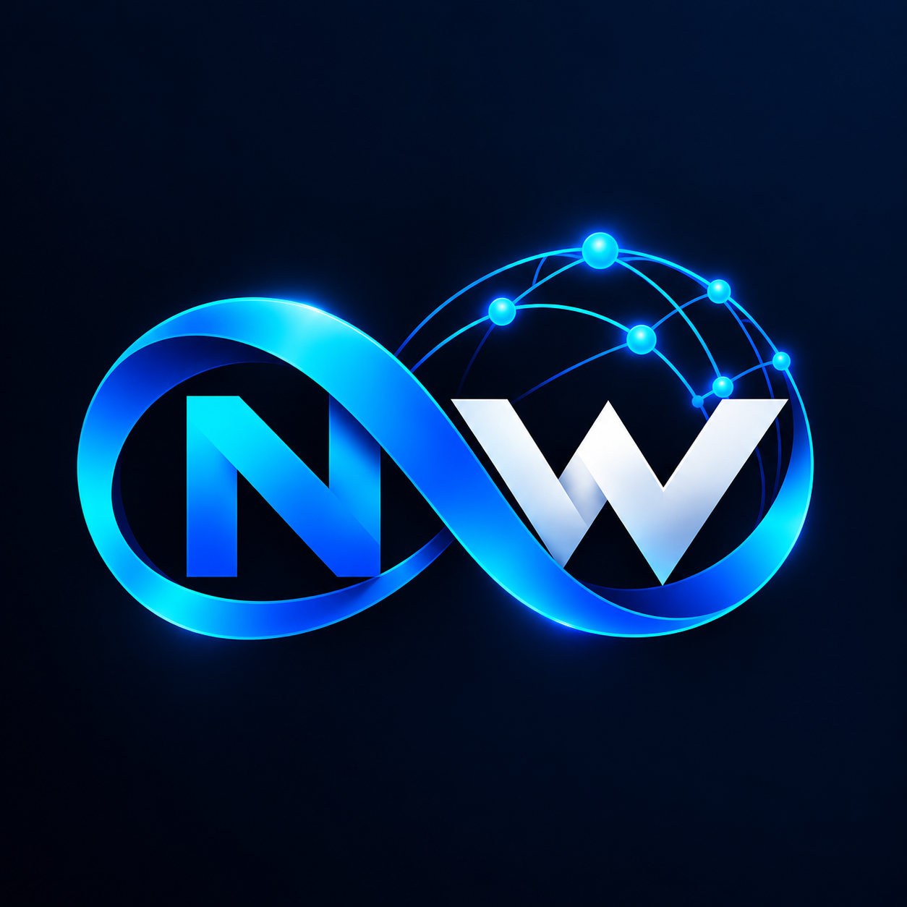

  

<h1 align="center">NWNC</h1>

  

  
  
  

  

NWNC (NW Network Chat) is a Python-based local network messaging tool that lets users chat over a TCP socket server with a desktop interface. It includes client/server communication, message handling, and a GUI for managing connections.

## Overview

NWNC is designed for local network communication in environments where users need quick and reliable messaging between machines on the same network. The application combines a lightweight socket-based backend with a desktop interface to provide a practical chat experience without external cloud services.

## Features

- Real-time local network messaging
- TCP socket-based client/server communication
- Desktop GUI for connection management
- Lightweight and easy to extend
- Suitable for LAN and internal team communication
- Simple architecture for local deployment

## How it works

The project uses a Python-based server to listen for incoming connections, while the client side communicates with the server over the local network. The GUI helps users manage connections and messages more easily.

## Project goals

NWNC aims to provide a minimal but useful messaging solution for local-area communication, especially in scenarios where users want secure and fast collaboration without relying on internet-based platforms.

## Usage

- Start the server on your local network.
- Launch the desktop client.
- Connect to the server using the correct address and port.
- Send and receive messages in the chat interface.

## Architecture

NWNC consists of:

- a server component for handling connections and message routing
- a client component for communication
- a desktop UI for user interaction and connection control

## License

This project is licensed under the MIT License. See the LICENSE file for more information.

## Contributing

Contributions are welcome. If you want to improve the project, feel free to open an issue or submit a pull request.

## Disclaimer

NWNC is intended for trusted local network environments and should be used responsibly.
